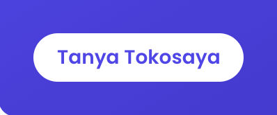
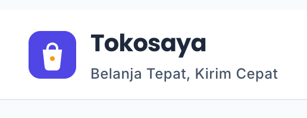
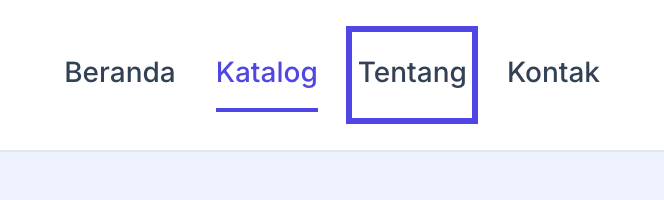
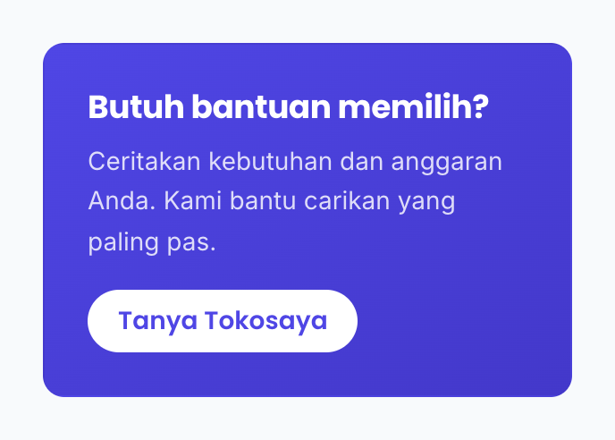
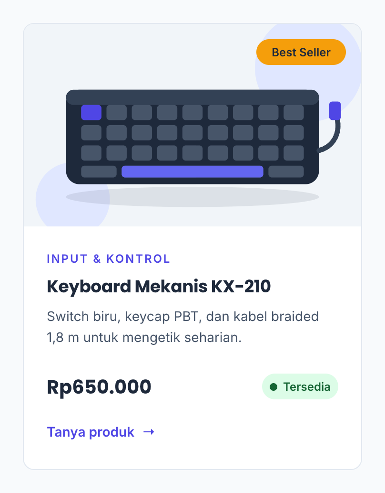

# UTS Praktek — Frontend Development

## Bagian A — Build (Soal 1–5)

### Soal 1 — Tombol “Tanya Tokosaya”

*Tombol putih pada latar gradient panel. Latar panel tidak perlu dibuat.*

#### Yang harus dikerjakan

Tuliskan HTML dan CSS untuk menghasilkan tombol tersebut. Tombol mengarah ke `kontak.html`, berbentuk pill, dan berubah warna saat `:hover`. Gunakan class kebab-case.

### Soal 2 — Brand di header

*Logo, nama toko, dan tagline tersusun horizontal.*

#### Yang harus dikerjakan

Tuliskan HTML dan CSS untuk brand tersebut. Gunakan `img-produk/logo-tokosaya.svg` sebagai logo dekoratif (`alt=""`), nama toko, dan tagline yang lebih kecil. Pastikan logo dan teks sejajar secara horizontal.

### Soal 3 — Navigasi aktif dan fokus

*Katalog aktif (garis bawah); Tentang fokus keyboard (outline).*

#### Yang harus dikerjakan

Tuliskan HTML dan CSS navigasi: daftar tautan, keadaan aktif, dan keadaan `:focus-visible`. Jangan menghapus outline fokus. Tautan aktif harus ditandai dengan `aria-current="page"`.

### Soal 4 — Panel bantuan di sidebar

*Panel gradient indigo dengan teks putih dan tombol putih.*

#### Yang harus dikerjakan

Tuliskan HTML dan CSS panel bantuan. Gunakan latar gradient indigo, teks putih, dan tombol putih. Teks:

> **Butuh bantuan memilih?**
> Ceritakan kebutuhan dan anggaran Anda. Kami bantu carikan yang paling pas.

Tombol: `Tanya Tokosaya`, mengarah ke `kontak.html#form-kontak`.

### Soal 5 — Kartu produk utuh

*Kartu produk pada tampilan desktop 1280 px.*

#### Yang harus dikerjakan

Bangun kartu lengkap dengan ketentuan berikut.

- Gunakan elemen semantik yang tepat untuk satu kartu produk.
- Gambar memakai `img-produk/keyboard-kx210.svg` dengan rasio **5:3**.
- Badge menempel di pojok kanan atas area gambar.
- Harga dan stok berada di dasar kartu; tautan berada di bawahnya.
- Kartu harus tetap rapi saat ditempatkan dalam baris flex bersama kartu lain.

| Bagian | Teks |
|---|---|
| Kategori | `INPUT & KONTROL` |
| Nama | `Keyboard Mekanis KX-210` |
| Deskripsi | `Switch biru, keycap PBT, dan kabel braided 1,8 m untuk mengetik seharian.` |
| Harga | `Rp650.000` |
| Stok | `Tersedia` |
| Tautan | `Tanya produk →` |
